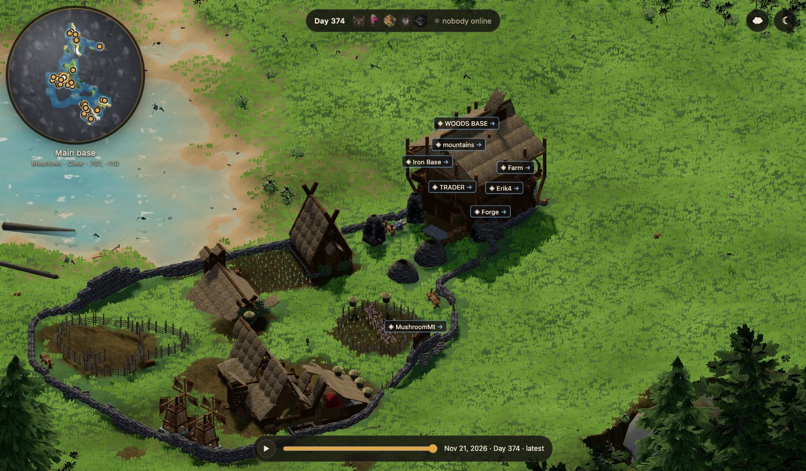
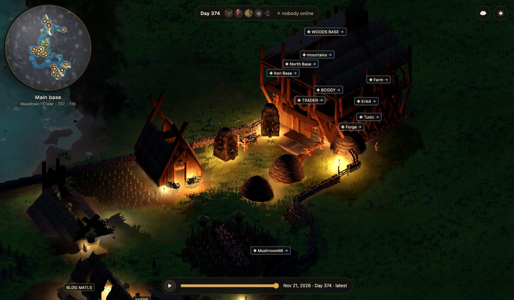
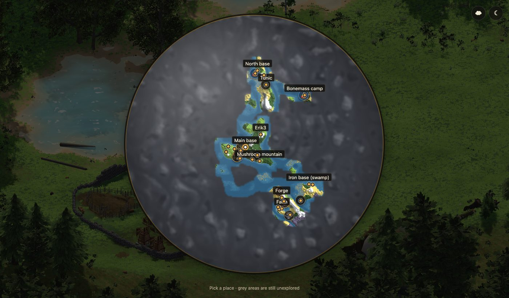

# valheimdisplay

**A 3D website of your Valheim world.** Run one program next to your Valheim server and everyone
on it gets a page where they can see your bases in 3D, built with the game's own models on
the real terrain. Think [Minecraft Overviewer](https://overviewer.org), for Valheim.



| | |
|---|---|
|  |  |

- **Every base, automatically.** It finds the places people have built and renders each one with
  its terrain, buildings, trees, rocks, water and grass. Portals are clickable and take you to
  where they lead.
- **A round world map** of everything that's been explored, with boss altars, traders, ships and carts.
- **A timelapse:** scrub through the days and watch the bases go up (and get torn down).
- **Weather that fits each biome** (rain in the Meadows, mist in the Black Forest, snow in the
  Mountains, ash in the Ashlands), and a night mode with working fires and torches.
- **Boss progress, the in-game day, and who's been playing:** hours, deaths and who's online
  right now, read from the server's log.
- **Works on phones.**

It reads the world save directly, regenerates the terrain from the world seed, and pulls models
and textures out of the game files already on your machine. Nothing from the game is included
in this repository or in the downloads.

## Quick start

1. **Download** the program for the computer that runs your Valheim server:

   | System | Download |
   |---|---|
   | Windows | [valheimdisplay-windows-x64.exe](../../releases/latest/download/valheimdisplay-windows-x64.exe) |
   | Linux (x64) | [valheimdisplay-linux-x64](../../releases/latest/download/valheimdisplay-linux-x64) |
   | Linux (ARM, e.g. Raspberry Pi 5, Oracle Ampere) | [valheimdisplay-linux-arm64](../../releases/latest/download/valheimdisplay-linux-arm64) |
   | macOS (Apple Silicon) | [valheimdisplay-macos-arm64](../../releases/latest/download/valheimdisplay-macos-arm64) |
   | Docker, or anything else | see [Docker](#docker) and [Running from source](#running-from-source) |

2. **Run it** on that computer:
   - **Windows:** double-click it. Windows warns about an unknown publisher the first time
     (the program isn't code-signed): click *More info → Run anyway*.
   - **Linux:** `chmod +x valheimdisplay-linux-x64 && ./valheimdisplay-linux-x64`
   - **macOS:** `chmod +x valheimdisplay-macos-arm64 && xattr -d com.apple.quarantine valheimdisplay-macos-arm64 && ./valheimdisplay-macos-arm64`

3. **Open http://localhost:8080.** Friends on the same network use `http://<that computer's address>:8080`.

The first build takes a few minutes while it reads the game files. After that it keeps itself up to
date: when the server saves, it rebuilds (at most once an hour, and only if someone has played).
Leave it running alongside the server. It keeps everything in a `valheimdisplay-data` folder
next to the program.

### What it needs

- **The world save.** Valheim's current save format: a world folder holding `_main.N.db2`,
  `_main.N.chunks` and `*.chunk` files. Worlds saved as a single `World.db` file (older versions
  of Valheim) aren't supported.
- **The game files**, for models and textures: the dedicated server's `valheim_server_Data`
  folder, or the game's own `valheim_Data`.
- **Optional: the server's log**, for player stats.

It looks for these itself: first in a running `valheim_server` process (its install folder and its
`-world`, `-savedir` and `-logFile` options), then in your Steam libraries and the default save
folders. Run `valheimdisplay detect` to see what it found.

## Settings

If it can't find something, or to change the port, edit `valheimdisplay-data/valheimdisplay.toml`
(created on the first run). Every setting is optional:

```toml
world = 'C:\Users\you\AppData\LocalLow\IronGate\Valheim\worlds_local\MyWorld'
game = 'C:\Program Files (x86)\Steam\steamapps\common\Valheim dedicated server\valheim_server_Data'
server_log = 'C:\valheim\server.log'   # or "journal:valheim.service", or "none"
port = 8080
bind = "0.0.0.0"          # "127.0.0.1" to only serve this computer (e.g. behind a reverse proxy)
rebuild_minutes = 60
players_minutes = 3
```

The same settings work on the command line, for example
`valheimdisplay --world DIR --game DIR --log FILE --port 8080`.
`valheimdisplay build` builds once and exits, and `valheimdisplay --help` lists everything.

**Player stats** (hours played, deaths, who's online) come from the server's log.
- On Linux with the server running as a systemd service, the log is found automatically.
- Otherwise, start the server with `-logFile <path>` and the viewer picks it up. Add it to
  `start_headless_server.bat` or `start_server.sh`.

Without a log, everything else still works. Hours are approximate for crossplay players (the log
doesn't always say which crossplay player left), but deaths are counted exactly.

**Naming places.** Places are found and named automatically: by a portal's tag, else a sign's
text, else "Outpost N" (the rules are in `tools/places.py`). To choose names or sizes yourself,
copy `regions.example.json` to `valheimdisplay-data/regions.json` and edit it:

```json
[{"slug": "main", "title": "Main base", "x": 705, "z": -113, "radius": 150}]
```

`x` and `z` are world coordinates (the place picker shows them under each place's name). An entry
renames and resizes the automatically found place it falls inside.

**The timelapse** starts from the backups Valheim keeps of the world (the `<World>_backup_*`
folders next to it), and the program adds a snapshot each time it rebuilds.

## Sharing it with friends outside your network

The site is plain web pages, so any way of publishing a local web server works:

- Forward port 8080 on your router to the computer running it.
- Or put it behind a reverse proxy with HTTPS. [`deploy/`](deploy) has a working example
  (Caddy plus a systemd service).

Anyone who can open the site can see your players' character names and play times. It doesn't
show Steam or Xbox IDs, IP addresses, or what anyone is carrying.

## Docker

For servers that run in Docker. Mount the world folder, the game files and a volume for the data:

```sh
docker build -t valheimdisplay https://github.com/benjaminsanborn/valheimdisplay.git
docker run -d --name valheimdisplay -p 8080:8080 \
  -v /path/to/worlds_local/MyWorld:/world:ro \
  -v /path/to/valheim_server_Data:/game:ro \
  -v valheimdisplay-data:/data \
  valheimdisplay
```

For player stats, also mount the server's log file and point at it:
`-v /path/to/logs:/log:ro -e VALHEIM_LOG=/log/server.log`.

## Running from source

Works anywhere Python 3.12 runs, including Intel Macs. You need [uv](https://docs.astral.sh/uv/):

```sh
git clone https://github.com/benjaminsanborn/valheimdisplay.git
cd valheimdisplay
uv sync
uv run python tools/valheimdisplay.py          # same as the downloaded program; this folder is the data folder
```

## Troubleshooting

| Problem | Fix |
|---|---|
| "No world save found" | Set `world` to the folder holding `_main.N.db2`. On a dedicated server that's `worlds_local/<World>` under the save folder: `-savedir` if the server sets one, otherwise the default for its OS (Windows `%USERPROFILE%\AppData\LocalLow\IronGate\Valheim`, Linux `~/.config/unity3d/IronGate/Valheim`). |
| "No Valheim game files found" | Set `game` to the `valheim_server_Data` folder inside the server's install folder. |
| The page says the build failed | The last lines of output are on the page and in the program's window. [Open an issue](../../issues/new/choose) with them. |
| A place is missing | A place needs at least 15 built pieces close together, or a portal. Or add it to `regions.json`. |
| No player stats | See *Player stats* above: it needs the server's log. |
| The page doesn't open from another computer | Allow port 8080 through the firewall on the computer running it. |

## How it works

| Step | Code |
|---|---|
| The program: find the server, rebuild when it saves, serve the site | `tools/valheimdisplay.py`, `tools/detect.py` |
| Read the save (`_main.N.chunks/.db2/.fwl2` and `*.chunk`) | `tools/vworld.py` |
| Choose which places to render | `tools/places.py` |
| Terrain: a port of the world generator, plus players' terrain edits | `tools/terrain.py`, `tools/rivers.py`, `tools/export_region.py` |
| Models, textures and icons from the game's asset bundles | `tools/export_models.py`, `tools/export_terrain_textures.py`, `tools/export_icons.py` |
| The world map, with explored areas | `tools/export_worldmap.py` |
| Timelapse history (pieces, explored areas, bosses, in-game day) | `tools/history.py` |
| Players (hours, deaths, who's online) from the server log | `tools/players.py` |
| One full build, in order | `tools/build.py` |
| The website ([three.js](https://threejs.org), vendored in `web/vendor`) | `web/app.js`, `web/index.html` |
| Weather per biome | `web/weather.js` |

Everything the program generates lives in its data folder: `data/` (a copy of the world, and the
history) and `web/assets/` (terrain, models, textures). None of it is committed, because it comes
from Iron Gate's game files.

### Developing

```sh
uv sync
uv run python tools/valheimdisplay.py build    # one build, no web server
uv run pyinstaller valheimdisplay.spec         # build the executable into dist/
```

GitHub Actions builds the executables for every platform on each push to `main`
(`.github/workflows/release.yml`). Pushing a `v*` tag publishes them as a release.
To add old saves to the history: `uv run python tools/history.py backfill <backup .tar.gz or folder> ...`.

Known gaps:
- Rivers are approximate.
- Only the current (chunked) save format is read.
- Pieces added by mods aren't shown.

## License

The code is under the [MIT license](LICENSE). three.js (in `web/vendor/three`) is MIT-licensed
by its authors.

This is a fan project. It is not made by, affiliated with, or endorsed by Iron Gate or Coffee Stain.
Valheim, its models and textures belong to Iron Gate AB. This project doesn't distribute any of
them: each copy reads them from the game files its user already has.
